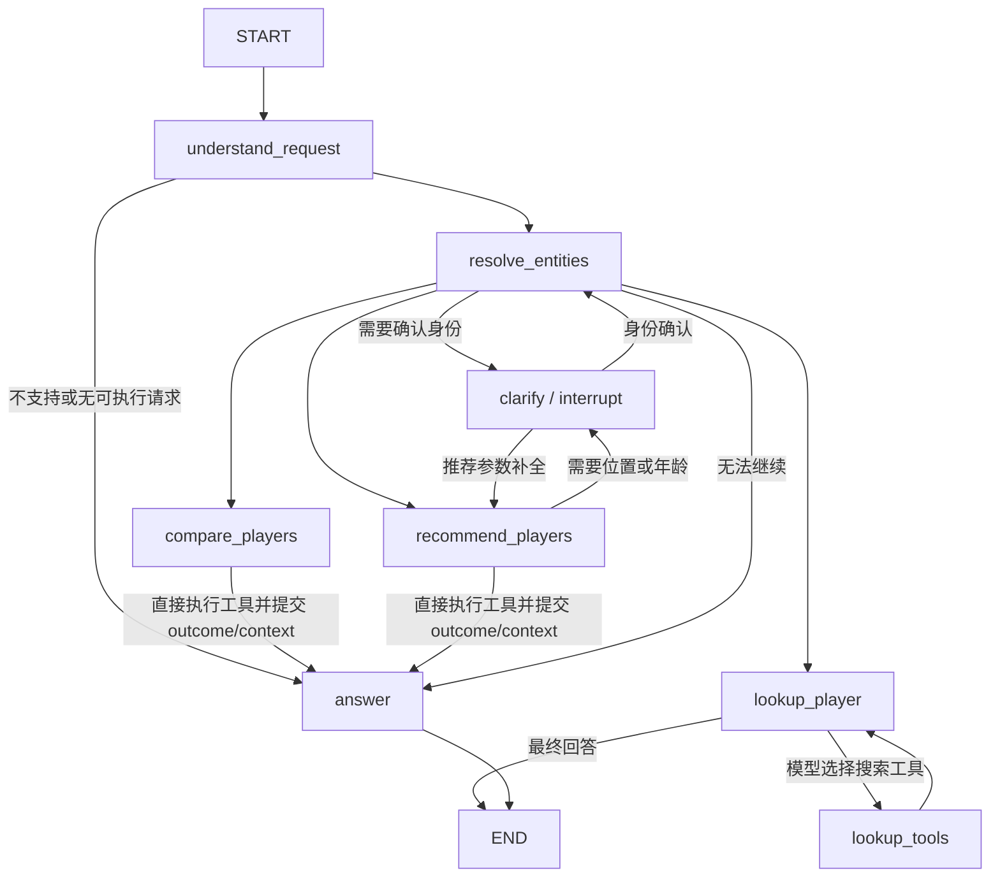

# Agent 工作流对抗性审查

Status: resolved
Labels: ready-for-human

日期：2026-10-25。审查对象：当前未提交的 `src/`、推荐落地方案，以及最近提出的“三业务 node + 共享 ToolNode + 独立记忆 node”方案。无向前兼容要求。本次只做静态阅读、只读 SQLite 查询和官方文档核对；没有修改应用源码，没有运行测试。

## 从需求推导，而非从框架能力推导

必须保证的行为：

1. 球员称呼只绑定到经过验证或用户确认的身份，跨来源同名不自动合并；确认过的别名在同 thread 可复用。
2. 查询、比较、推荐各有明确执行策略；计算和硬条件由代码负责，模型解释证据。
3. 身份、目标位置、年龄上限不明确时，澄清后继续同一请求，不丢参考球员或已确认条件。
4. 已完成的比较/推荐及空结果可供下一轮细化；数据失败不覆盖已完成上下文。身份别名确认和查询完成具有不同提交时间。
5. 用户的否定、排除和未知硬条件不能被静默改写或忽略；“未提及条件”与“明确清除条件”必须区分。
6. 线程隔离由 LangGraph checkpointer 提供，当前使用内存实现。

没有需求证明必须让所有任务经过同一个 ToolNode、把每次 state 赋值独立做成记忆 node、增加通用 planner/phase 状态机或保留未使用的 Store。

## 已确认的代码问题

### P1：身份确认没有约束查询读取的真实记录

`assistant.ts:135–174` 只把工具参数 playerName 改成 selectedName；`tools/search-player-records.ts:13–32` 根本没有 source ID 输入，也没有固定用户选择的 provider。FM 随后仍做姓名 LIKE、排序和 LIMIT（`football-manager.ts:466–478`）；Understat 也按姓名匹配后先截断。用户确认的同名者可能被 LIMIT 排除，其他同名者却进入结果。结果中的 identityGroups 只是注释已有记录，不会把查询绑定到本轮身份。

比较工具在 name search 后再按 source ID 过滤（`compare-records.ts:254–264`），可避免用错同名者，但选定记录如果已被前面的 LIMIT 截掉，仍会误报缺失。身份别名记忆再完善也无法修复这个契约缺口。

应明确拆开“发现候选”与“读取已确认资料”：姓名搜索只用于身份候选发现；确认后数据读取必须按具体 FM/Understat source IDs 和用户选择的 provider 精确获取。lookup 的模型即使保留工具循环，也不能自由改写已确认的 source IDs。

### P1：当前推荐 reader 不能读取真实 manifest

`src/player-data/football-manager.ts:218–226` 和 `:357–363` 把 `manifest.payload` 直接传给 Zod object parser。只读 SQL `SELECT typeof(payload) FROM manifest WHERE id=1` 返回 `text`；它实际是 JSON 字符串，应先 JSON.parse/parseJson。当前两个路径都会进入 catch 并返回 unavailable。lint/typecheck 通过不能证明这条数据链路运行成功。

同文件 `:237–240`、`:395–408` 把 SQLite `.get()` 的无行结果交给 `.nullable()`；安装的 Node 类型声明 `node_modules/@types/node/sqlite.d.ts:534` 明确返回 `Record<...> | undefined`。不存在的 FM ID 因此被误报成数据源故障，而非缺少参考资料。

### P1：无否定语义的关键词覆盖了用户意图

`src/nodes/request-understanding.ts:84–92` 将 PA/young/潜力正则匹配 OR 到结构化结果上。

- “只看当前能力，不考虑 PA”仍启用高潜名单。
- “不要年轻球员”仍触发年轻请求，并可能要求年龄上限。

结构化提取完成后，不应再用裸关键词强制改写意图。应保留明确的三态变更语义，并由受控提取结果决定是否启用潜力名单。

### P1：别名补漏会把排除对象变成参考对象

`src/nodes/request-understanding.ts:69–76` 对补漏别名强制赋值 `recommendationRole="reference"`。如果模型漏掉“不要哈兰德”中的哈兰德，补漏会把他加入平均参考画像。身份绑定只能补充身份，不能猜 reference/exclude 角色；角色不明应澄清。

### P1：澄清目前没有恢复路径

位置不明确时工具返回 `position_required`（`src/tools/recommend-player-candidates.ts:184–196`）；年龄问题由 `request-boundary.ts:38–40` 回复后结束。下一条消息会重建 request（`request-understanding.ts:129–141`），且没有 activeRecommendation。因此回复“中锋”或“23”会丢掉原参考集合。

之前提出的 `clarify → recommend` 回边直接接到当前实现也不成立：`assistant.ts:257–270` 只按 ToolMessage 名称判断是否已执行，旧 `position_required` 会挡住新调用。三业务 node 的拆分本身不能修复这个问题。

### P1：未知硬条件可能被静默丢弃

提取器保留任意字符串 constraints，但 `assistant.ts:298–306` 只把有限的 typed recommendation 字段传给工具。预算、惯用脚、当前球队等条件可能只留在提示词中而未参与计算。应先返回 `unsupported_constraint`，不能用删减条件后的请求生成候选。

### P2：统计和身份去重错误

- `recommend-players.ts:690–706` 需要全部有 PA 的候选数量，调用处 `:782–786` 却传入已截断的 Top K 长度。10,000 人 PA 完整、K=5 时会报告 9,995 人缺 PA。
- `recommend-player-candidates.ts:98–113` 对同 identityKey 只保留第一组。第一组缺 FM、第二组有正确 FM ID 时会误报缺失；调换顺序结果不同。身份阶段应产出唯一确定的 FM profile，推荐工具不再二次处理人物分组。

### P2：其他生命周期缺口

- `entity-resolution.ts:1023–1027,1237–1242` 在查数据前更新 lookup focus；后续查询失败仍改变“他”的指代，与 `CONTEXT.md` 的完成后提交语义不符。确认别名应立即保留，focus 和 completed-query context 应在数据成功时提交。
- `comparison-context.ts:77–86` 对“2026赛季”可能得到 undefined，然后静默查询最新赛季；应提取 typed seasonStartYear，不能解析就澄清。
- nullable 默认同时表示省略和清除。下一步若做 refinement，将无法区分“年龄未提及，继承原条件”与“取消年龄限制”。

## 原方案中可以删除的复杂度

### 固定工作流不需要伪造模型工具调用

比较与推荐的工具、参数来源和执行顺序都由代码确定。人为生成 `AIMessage.tool_calls`、经过共享 ToolNode、再扫描同名 ToolMessage 识别第二阶段，增加了协议状态和回边。

保留工具接口即可：业务 node 直接调用确定性工具 `.invoke()`，获得 typed outcome。只有真正由模型自主选择工具的 lookup loop 使用 ToolNode。

### 记忆赋值不必单独成为 graph node

`remember-comparison.ts:13–37` 只是条件检查和 state patch，没有独立 I/O、重试或中断。compare/recommend 执行 node 可在工具成功后一次返回 outcome 和记忆补丁，不需要 remember_comparison / remember_recommendation 两个额外节点。

共享 answer node 则有明确理由：计划把 ready/no_candidates 视为已完成数据查询，并在解释前保存。执行 node 先提交结果与上下文，answer 的模型超时只重试解释，下一轮细化仍能看到最新已完成查询。

### 统一一种澄清通道

用一个 tagged `pendingClarification` 表达 identity / position / age（必要时 role），由一个 clarify node 调用 interrupt 并验证 resume。保留解析进度与问题候选的 checkpoint，避免把 interrupt 放回长 resolver 后重放已经做过的查找。

当前散落的 status、activePlayerIndex、clarificationMessage、requestAnswer 和 resolution.status/message 不应继续共同表达同一问题。

### 删除没有消费者的机制

- `InMemoryStore` 只在 `agent.ts` 创建和传入，没有读取或写入消费者。当前 thread memory 用 checkpointer 即可。
- 无兼容要求时，删除从历史 ToolMessages 重建 activeComparison 的 fallback（`comparison-context.ts:149–259`）；只保留一个 typed completed context。
- 图位置已表达的执行阶段，不另存多套 phase/flags。对模型驱动 lookup，调用关联使用原生 tool_call_id；固定比较/推荐不再有虚构 toolcall 状态。

## 收敛后的最小方案

保留八个真实 graph node：

1. understand_request
2. resolve_entities
3. clarify
4. lookup_player
5. lookup_tools（仅查询的原生 ToolNode）
6. compare_players
7. recommend_players
8. answer



lookup 保留工具循环是因为用户此前明确要求最小 Agent loop。如果 lookup 的实际目标仅是确认身份后做一次固定数据读取，它也可以改成固定工作流；单纯为了展示 ReAct 而保留循环没有产品收益。比较、推荐目前没有模型自主规划需求，应保持固定工作流。

answer 只解释当前 typed outcome，没有工具、不能改排序/条件；无数据的错误与不支持说明优先固定文案，不为一句错误消息再调 LLM。

## 最小 state

```text
messages                 原生消息 reducer，仅 lookup 保留原生工具消息
turn
  id
  task                   lookup / comparison / recommendation 的 typed union
  participants           一份实体称呼、明确角色和身份解析记录
outcome                  当前执行的 typed 结果，供 answer checkpoint/解释
pendingClarification     null / identity / position / age，至多一个
context
  confirmedAliases       用户确认后即可提交
  focusPlayers           lookup 数据成功后提交
  activeComparison       最近完成的有效比较查询
  activeRecommendation   最近完成的有效推荐查询、TopK身份与版本
```

state 不保存整个候选库、格式化 prompt、可以计算出的 missing-role flags、历史消息恢复副本或未使用 Store。除 messages 外，串行流使用 last-value 更新即可，不需要自定义聚合 reducer。

新请求与修改请求必须区分。提取的变更中：键缺省表示继承，null 表示明确清除，具体值表示设置；理解节点合并后生成一份有效查询，后续节点只消费这一份查询。不能把 patch 和 effective query 两套数据长期作为并列真值保存。

## 业务文案与实验结论边界

- 高潜榜以 PA 为主、参考相似度只是并列条件，因此相同位置和条件的“凯恩高潜名单”与“哈兰德高潜名单”可能相同。应称“该位置高潜名单”，不能暗示未来属性像参考球员。
- 多参考平均画像回答“接近算术平均”，不保证同时接近每个人；不同特点可能相互抵消。
- 明确 minCA 会同时淘汰低 CA 高 PA 候选。不能为了高潜名单悄悄放宽硬条件。
- RMSE 实验只验证固定扰动下的工程稳健性。单/双/三参考混合宏平均不等于分别验证了各类推荐质量；没有独立相关性标签，provisional 标记必须保留。
- runtime feature map 和实验 JSON 的内容应自动校验或从同一 registry 生成，不能只硬编码一个 SHA 声称一致。

## 下一次实现的验证重点

先修有事实证据的 reader/统计/意图问题，再做图重构。验证集中在现有已约定的公开 seam：数据 reader 和 ranker 的结构化结果、完整 graph invoke/stream/Command-resume，而非节点内部实现。

必要场景：TEXT manifest、缺失 FM ID、否定 PA、别名作为 exclude、位置/年龄中断继续原参考集合、取消年龄限制、工具失败保留完成上下文、空候选可继续放宽、模型解释失败仍保留完成查询、跨 thread 隔离。公式未改变时不重跑全部离线公式实验。

## 官方依据与本审查判断

LangGraph 官方区分预定代码路径的 workflow 和自主使用工具的 agent；node 本身是接收 state 返回更新的函数，不要求所有数据操作都通过 ToolNode。节点粒度应服务 checkpoint、重试和中断需求。本报告关于删除 synthetic toolcall 与 remember node 的建议，是据此对本项目做出的工程判断。

interrupt 恢复会重启中断 node，执行 interrupt 前的代码会重复；因此 clarify node 保留为一个真实用户输入 checkpoint。当前安装 LangGraph 版本为 1.5.2。

- [官方 workflows / agents](https://docs.langchain.com/oss/javascript/langgraph/workflows-agents)
- [官方 node 粒度与 state 设计](https://docs.langchain.com/oss/javascript/langgraph/thinking-in-langgraph)
- [官方 interrupt 恢复语义](https://docs.langchain.com/oss/javascript/langgraph/interrupts)
- [官方 state channel / reducer](https://docs.langchain.com/oss/javascript/langgraph/graph-api)
