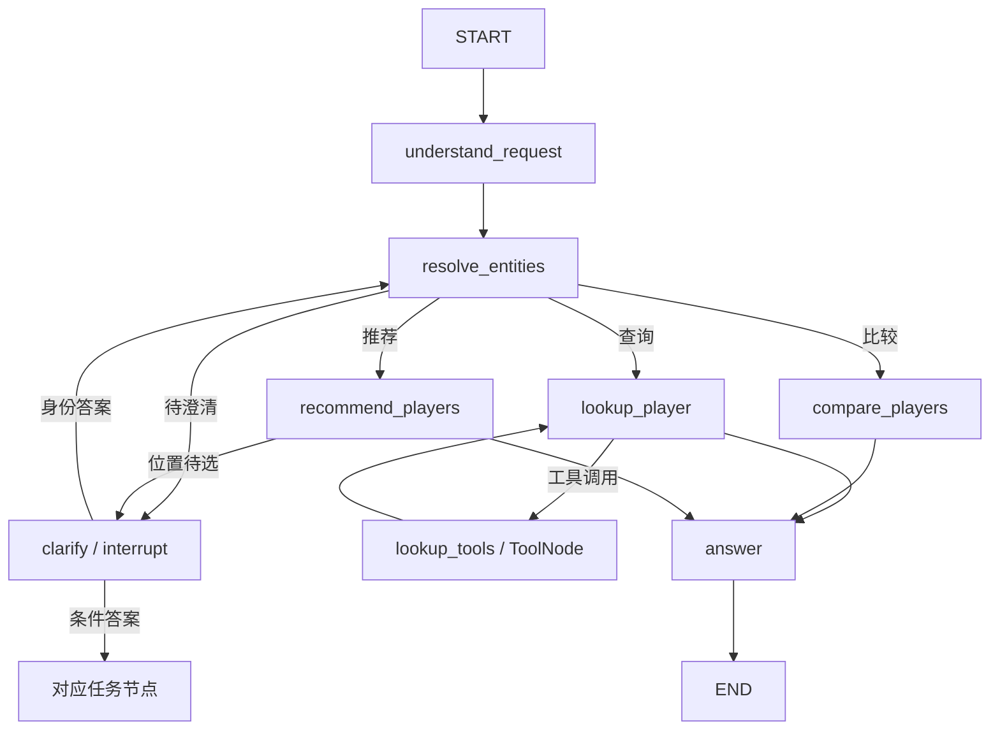

# 全位置 FM 能力相似与潜力推荐：实现记录

Status: resolved
Labels: ready-for-human

2026-10-25 完成架构对抗审查后的实现。审查确认的数据读取、身份契约、否定意图、澄清恢复、硬条件、上下文提交和统计问题已修复；修订依据见[架构审查](architecture-review.md)。离线公式实验结论与应用运行正确性分开看待。

代码基线起点：`50f28cf`（球员身份与比较）和 `d30be7e`（工程化配置）。推荐功能已完成实现与离线验证。领域决策记录见 [ADR-0006](../../docs/adr/0006-position-aware-recommendation.md)，数据事实见[数据审计](data-audit.md)，全位置实验协议与结果见[实验方案](experiments.md)、[实验报告](multi-position-report.md)和[冻结选择记录](experiment/selection-global.json)。

## 1. 目标和边界

基于本地 Football Manager（FM）快照，给一个或多个已确认身份的参考球员找位置和能力属性相近的候选。支持快照中有数据的全部具体位置；`SW` 当前没有可用画像，明确返回不支持。

主结果回答“谁现在的 FM 属性画像接近参考球员”。当用户明确提到年轻球员或潜力时，再增加一份独立的“高潜候选”名单。PA 不混进当前相似度公式，也不推测球员未来会达到的属性或 CA。

此功能不判断现实转会可行性、当前球队、费用、合同、现实比赛表现或具体战术角色。只读取本地 FM 数据；不接 Understat、不做 RAG、不加前端或业务数据库。

示例：

> 给凯恩找中锋能力相近的候选，最多 5 人。

> 给凯恩找 23 岁以下的高潜中锋，最多 5 人。

第二种请求会分别给出当前属性相似名单和潜力名单；两份名单使用不同的排序依据并清楚标记。

## 2. 已确认的产品规则

| 项目 | 规则 |
| --- | --- |
| 参考球员 | 支持一名或多名；每个称呼都先走现有身份解析。相同身份去重。 |
| 目标位置 | 用户明确指定时优先使用。未指定时，只有参考球员集合的 `natural_positions` 交集恰好有一个位置才自动选择；交集为空或有多个位置时追问。 |
| 参考球员位置门槛 | 集合内每个人在目标位置的 FM 评分都必须至少为 15；否则说明原因并请用户调整位置或参考球员。 |
| 候选位置门槛 | 候选的目标位置评分至少为 15。评分只用于入选和展示，不加入能力相似度排序。 |
| 多参考球员 | 对选定位置的每项 raw 属性作等权算术平均，形成合成参考画像；候选按当前能力公式与此画像比较。答案应称其为“参考球员平均画像”，不得冒充真实球员。 |
| 当前能力相似 | 按目标位置的冻结属性集和全局选定距离公式排序。CA、PA 单独展示；CA 只在用户明确要求时作为硬筛选。 |
| 高潜名单 | 用户提到年轻/潜力时追加，按 PA 从高到低排序；同 PA 时按当前属性距离从近到远，再按 FM ID 稳定排序。当前属性距离仅作说明和并列排序，不与 PA 合成分数。 |
| 年龄 | 默认不限；用户给出年龄条件时按 FM 快照日期 `2025-11-23` 计算，并应用到所有返回名单。仅说“年轻”但未给年龄上限时先追问，不暗设 U21/U23。 |
| 潜力条件 | PA 默认不设硬阈值；高潜名单直接按 PA 降序。用户明确给出最低 PA 时执行筛选。PA 高表示 FM 快照中的潜力上限信号，不代表一定达到。 |
| 结果数 | 每份名单默认 Top 5，允许 1–20；同一球员可以分别出现在当前相似和高潜名单中，因为两者回答不同问题。 |
| 排除对象 | 用户明确排除的球员也先解析身份，再从所有名单中排除。参考球员自身不能出现在候选列表。 |
| 数据范围 | 只用 FM 画像和位置评分；不要求 Reep/Understat 关联。缺失 FM ID 或必需属性的候选排除并计数。 |

位置评分 `>=15` 是本产品选择的数值门槛；代码和回答不把它误称为“Natural”。目标位置推断读取 `natural_positions` 字段，不用 `rating=20` 代替该字段。

## 3. 位置属性模型

本地快照有 52 项完整的 `raw_attributes_*` 属性，含门将专用属性。为每个有数据的 FM 位置建立单独的版本化属性清单，并把属性分成可解释的组，以便解释距离和执行消融。左右镜像位置可以使用相同属性清单，但仍分别报告实验结果。

属性清单已在公式实验前冻结为 `fm-position-features-v1`，SHA256 `de7880a59a29e34fb28f93957af614552697bf125e40a95edc5b64703f408c88`，包含每项选择理由和来源。它是透明的领域先验，不是从现有 `role_scores` 反推；该字段没有可审计的计算来源。没有战术角色输入，因此产品文案只能说“位置级 FM 能力相似”，不能说某个战术角色适配度高。

实现提交时，pre-commit formatter 仅规范化了 JSON 空白，导致原始字节哈希从实验时的 `37f9719a4ef2ab2242da622e716bfa0f36d1be6d8cb2468db477005b15f54e20` 变为当前值。位置、属性分组及顺序的测试逐项一致；实验结果未因序列化空白变化而重跑，实验元数据和后续复现配置已同步当前文件哈希。

映射覆盖 14 个有候选的位置；`SW` 因没有评分至少 15 的候选不进入映射，也不进入全局选型平均值。完整映射见 [JSON](position-feature-map.json) 和[说明](position-feature-map.md)。

## 4. 排序和实验决策

### 历史中锋结果的适用范围

[已有实验报告](experiment-report.md)只覆盖 STC 属性集和 STC 候选池。`rmse18` 是该实验的暂定工程默认，不能直接当作全部位置的全局公式。报告及 `selection.json` 保留为可复现的历史结果。

### 全位置实验

已完成[全位置实验报告](multi-position-report.md)，14 个有数据的具体位置各自使用冻结属性集；每个开发/测试集位置有 120 个请求（单参考、双参考和三参考），共 1,680 个开发请求和 1,680 个测试请求。比较 MAE、RMSE、余弦、中心化余弦/相关、标准化 RMSE、收缩协方差 Mahalanobis、预注册权重 MAE；并对位置属性组做消融。控制组为随机排序和 CA-only。

按 FM ID 在全库范围一次性划分拟合集、开发集和测试集；跨位置重复出现的同一 ID 只属于一个集合。查询参考身份跨位置、跨查询均不重复；标准化参数和协方差只从拟合集估计。所有算法对同一查询使用相同候选池、位置评分门槛和用户条件。

全局指标按**具体位置等权宏平均**。RMSE 在开发阶段胜过 MAE，测试 Top5 扰动稳定性差为 +0.073，配对 95% 区间为 [0.064, 0.083]；14 个位置的最小单位置增益为 +0.050，全部通过预注册门槛。测试确认后，RMSE 作为一个**暂定全局工程默认**。这不是独立球探质量验证，不能宣称足球实战最佳。其他公式结果、消融、延迟和每位置区间见报告。

实验使用 14 个位置等权宏平均，开发集冻结选择、测试集单次确认，没有从测试集另挑赢家。若没有方法通过预注册门槛，回退 MAE 并标记 `inconclusive`；本次 RMSE 通过。高潜名单是 PA 确定性排序，不参与当前属性距离公式竞赛。

### 属性与公式版本

已冻结的暂定版本为 `strategyVersion=fm-position-global-rmse-v1-provisional`、`featureSetVersion=fm-position-features-v1`、`preprocessing=raw-1-100`。结果可追溯到具体位置的属性集合和同一快照。候选评分由代码完成，模型不能临时更换公式、权重或排序。

## 5. LangGraph 链路

实现保留八个真实节点：`understand_request`、`resolve_entities`、`clarify`、`lookup_player`、`lookup_tools`、`compare_players`、`recommend_players` 和 `answer`。只有查询路径使用 LangGraph `ToolNode` 和模型工具循环；比较与推荐由固定业务节点直接调用确定性工具，不生成合成工具消息，也没有独立记忆节点。

每个 graph 使用 `MemorySaver` 隔离 thread 状态，没有 `InMemoryStore`。查询工具参数中的 source IDs 会被身份解析结果覆盖。比较和推荐节点在结果为 `ready` 或空候选 `no_candidates` 时，在同一 state patch 中提交 outcome 和 thread context；数据异常和未完成澄清不会覆盖最近成功结果。共享 `answer` 只解释结构化结果；不支持条件与数据故障使用固定回复。

推荐工具只返回结构化 TopK 和统计，不把完整画像交给模型。过滤、位置特征、平均画像、距离和排序由数据模块决定。模型不得补出当前球队、合同、费用、未来能力或工具没有返回的事实。

## 6. 请求和线程状态

`request-understanding` 产出按任务区分的 typed request，为推荐参与者标记 `reference`、`exclude` 或 `ambiguous`，并提取用户明确提出的条件。所有提及经过身份解析；数据读取只使用选定的 provider source IDs，同名不会自动合并。

state 只保留一个 `pendingClarification`，用 kind 表示 identity、FM profile、position、age、role 或 season。位置、画像和年龄答案补进同一请求后继续对应任务；身份答案回到 resolver 继续处理尚未解析的参与者。request 不再保存重复的 status、activePlayerIndex 或 requestAnswer。

`conversationContext.activeLookup` 保存最近成功单球员查询的精确 source 结果和 resolved player，供“哪个赛季”等事实追问使用；它只在数据命中后更新。`activeRecommendation` 保存最近成功推荐的参考和排除身份、位置、有效条件、TopK 结果与结果状态；它与 `focusPlayers`、`activeComparison` 分离。

- 条件字段省略表示继承，显式 null 表示清除，具体值表示设置；state 只保存合并后的有效请求。
- 只改年龄、CA、PA、潜力名单或结果数的后续消息继承上次成功推荐的参考集合和位置。
- 明确“把 X 也加入参考”时解析 X 并重算等权平均画像；明确“换成 X”时重置参考集合。
- 失败、中断或身份不确定不覆盖上次成功状态；`no_candidates` 是完整查询，可以保存以便后续放宽。
- thread 隔离由 LangGraph 的 `thread_id` 与内存 checkpointer 保证。

## 7. 数据结果与回答

数据读取按目标位置使用 SQLite 位置索引先过滤 `rating >= 15`，再加载必要画像，应用年龄/CA/PA 条件和身份排除。每个候选只计算一次当前属性距离；完成全池排序后再截取 TopK。并列用 FM ID 稳定排序。

工具结果包含状态、参考名单和平均画像说明、目标位置、条件、FM 快照时间、数据/公式版本、过滤各阶段人数，以及当前相似和（如请求）高潜两份 TopK。每行显示姓名、年龄、位置评分、CA、PA、与参考平均画像的当前属性差距及主要接近项/短板。高潜名单明确写“按 PA 排序；这不是未来 CA 预测”。

`no_candidates` 返回每步剩余量，不自动放宽条件；`unsupported_position`、`reference_not_position_capable`、`insufficient_reference_data`、`invalid_constraint`、`data_unavailable` 均有稳定状态和用户可理解的解释。

## 8. 代码落点

- `src/agent.ts` 注册八个 graph 节点和条件边，使用 `MemorySaver`。
- `src/state.ts` 定义按 kind 区分的 request、一个 pending clarification、当前 outcome 和 thread context。
- `src/nodes/` 只包含实际注册的 request understanding、entity resolution、clarify、lookup、compare、recommend 和 answer 节点。
- `src/player-data/` 负责精确 source ID reader、比较数据组装、位置 feature map、推荐过滤与排序。
- `src/tools/` 定义查询、比较、推荐的 LangChain 工具契约；比较和推荐节点直接调用固定工具。
- `tests/` 用独立 `MemorySaver` 和 fake model 验证公开 reader、ranker 和完整 graph invoke/Command resume。

所有 TypeScript 使用箭头函数、`type` 和文件底部统一导出。图节点之外的领域 helper 不放进 `nodes/`。

## 9. 交付顺序

1. **数据与属性清单**：完成；冻结 14 个位置的 feature map 与解释组。
2. **全位置公式实验**：完成；保留脚本、配置、原始结果、全局选择记录与独立核验。运行实现时公式未改变，因此未重跑实验。
3. **确定性推荐数据层**：完成；覆盖 manifest JSON 文本、缺失 FM ID、FM/Understat 精确 source ID、PA 缺失统计与 feature map 同步。
4. **LangGraph 工作流**：完成；查询保留原生工具循环，比较和推荐由专属业务节点直接执行，澄清通过一个 interrupt 节点续接，多个 FM 画像会先由用户选定。
5. **推荐上下文**：完成；支持位置澄清、条件细化、身份继承、数据失败保护和 thread 隔离。
6. **Vitest 验收**：完成；Fake model、独立 `MemorySaver`、精确 ID、alias role、否定 PA、lookup 结果追问、赛季/位置/FM 画像/年龄 interrupt、空结果、失败保护、逐步身份确认和 thread 隔离均有覆盖；测试不访问网关。

## 10. 验收标准

- 14 个有候选的位置各自有固定、可解释、字段完整的属性组；`SW` 明确不支持。
- 每个参考和候选均满足目标位置评分至少 15；位置评分不会混入相似度公式。
- 多参考平均画像计算可手算；重复身份不会被重复加权；全部参考身份均从候选中排除。
- 用户没指定位置时，只在 natural-position 交集唯一时自动选择，其他情况走澄清；多参考里任何一人不满足评分门槛都不继续排名。
- 当前名单严格按实验选定的全局公式排序；高潜名单严格按 PA 降序，当前距离只作次级 tie-breaker；二者绝不合并成一个分数。
- 用户的年龄、CA、PA 条件在适用名单中 100% 满足；无条件时没有隐式过滤。
- TopK、排序、解释数值可复算，稳定并列、自身排除、缺字段、空池和异常状态都有测试。
- graph 使用每测例独立的 `MemorySaver` 与 fake model，不依赖网关或 Store。
- 报告把工程稳健性结论与真实推荐质量结论分开；没有独立相关性标签就不宣称“实战最优”。
