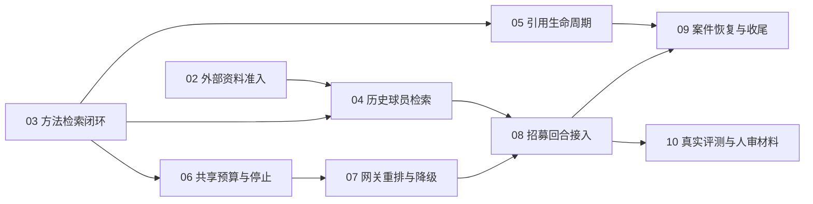

# 双路 RAG 纵向切片提案

Status: draft-awaiting-breakdown-approval
Updated: 2026-10-21

依据：[正式规格](spec.md)。保留现有 [父任务 01](issues/01-rebuild-knowledge-evidence.md)，不修改、关闭或将其列作子票阻塞项；子票拟从 02 开始编号。本文件是待审核的拆分提案，不是已发布的实现 tickets。

每张票通过管理入口、知识证据接口或现有招募回合完成可演示/可验证的行为，不新增 UI。必要的接口收口纳入最小检索闭环，过渡适配在案件接入后移除，不单独拆数据库、索引、模型等横向层级票。

## 02：获准外部历史资料准入与原文预览

**Blocked by:** None (can start immediately).

**What to build:** 资料维护者能从真实外部来源取得获准原文，形成可核验、可预览的历史球员资料包，供后续检索和人工审阅使用，不依赖新运行时存储格式。

- [ ] 使用项目已登记并获准的 PLOS 来源及官方 API 获取首批原文；不把只声明 CC BY 但另外要求 AI/RAG 许可的 SAGE 来源准入。
- [ ] 资料包保留原文、来源、作者、正文 hash、资料类别、核验主体、历史比赛及时间范围，并可通过管理预览直接检查所采用的段落。
- [ ] 方法章节与球员案例按内容分开，未知样本信息保持未知；不能标成职业球探意见、第一方记录或当前能力证据。
- [ ] 保存初始查询/原文支持素材及可复现的旧检索行为记录；原始全文和试验载荷按现有资料治理保存，不混入公开运行日志。
- [ ] 验证入口有确定性解析/许可用例，CI 不联网；实际资料尚未取得时明确阻塞，不用合成条目替代。问题标签属于初始项目标注，不冒充已完成用户复核。

## 03：中文方法检索与可解析引用的最小闭环

**Blocked by:** None (can start immediately).

**What to build:** 维护者发布一份已经获准的方法资料后，分析者可用中文查询获得相关英文原文和出处；关闭重开本地存储后，引用仍解析为相同原文。

- [ ] 以已有方法资料或获准夹具完成导入、最小结构解析、不可变原文版本、SQLite 权威记录与派生索引发布的完整通路。
- [ ] 公开检索/引用解析接口可返回片段、上下文、来源及稳定区间/hash；查询不依赖整库正文内存扫描。
- [ ] 使用原生 BM25、向量召回及 RRF，去掉中文词项覆盖对英文原文的旧硬门槛；片段相关性不扩散为同来源全部相关。
- [ ] 空语料、成功未命中和查询故障可区分；未获准片段不能进入候选，版本与原文一致性通过关闭重开验证。
- [ ] 保存现有方法检索的旧方案输入/结果与配置；必要的接口整理和临时内部适配保证现有应用与定向回归仍可构建，不要求兼容旧索引数据。

## 04：历史球员定性资料检索与报告资料投影

**Blocked by:** 02, 03.

**What to build:** 分析者对试点主体的查询能够取得真实历史分析观点，并在报告资料投影中看到作者、比赛、时间和原文依据；错误主体或试点之外的主体得到明确覆盖状态。

- [ ] 将已准入资料包接入新知识模块，完成按核验身份与样本范围的球员资料检索。
- [ ] 逐主体区分取得资料、试点未覆盖、成功零命中和预算未处理，同名球员不互相借用观点。
- [ ] 保留必要章节语境和原文引用，报告资料输出标明历史研究者观点、作者与样本限制，不当作近期球探报告。
- [ ] 通过模块及现有报告资料投影独立演示真实历史案例；不将论文球员强行加入当前候选池，不新增通用聊天界面。
- [ ] 验证历史观点不填补量化指标、不给未覆盖主体作能力负面判断，也不以研究者的评分替代系统的比赛证据。

## 05：更新、重建与撤回后的引用生命周期

**Blocked by:** 03.

**What to build:** 维护者更新资料或重建索引后，旧引用继续指向同版原文；来源撤回后，新检索与旧引用解析立即反映当前有效策略。

- [ ] 更新正文、解析规则或索引产生新版本，旧引用不静默转向新正文；活动索引之外仍可解析允许保留的旧原文。
- [ ] 暂存构建/校验失败时旧活动版本继续可用，成功发布后查询不暴露半成品。
- [ ] 来源撤回作用于新查询、缓存、重排前的数据使用及引用解析；重启不能从旧来源声明恢复撤回权限。
- [ ] 留存变化、原文缺失、hash 不符或版本不可得返回明确失效状态，不与零命中混同，不声称删除浏览器历史成品或所有磁盘历史字节。
- [ ] 通过公开管理与检索/解析接口验证重建、撤回、关闭重开及有授权/无授权两条路径，不绑定内部表结构。

## 06：同回合共享 15 秒预算与可停止检索

**Blocked by:** 03.

**What to build:** 一个用户回合中的多次资料查询共同遵守 15 秒额外等待预算，调用者可以及时停止，晚到结果不会继续产生证据或后续工作。

- [ ] 检索、embedding、原文加载和上下文处理共享可恢复预算，新回合才重置，同回合重复调用或恢复不返还已用额度。
- [ ] 不可协作取消的本地推理/查询不会阻止调用方在预算内返回，迟到结果被丢弃，不将等待结束说成底层计算已经停止。
- [ ] 区分超预算、用户取消和数据服务故障；额度耗尽后不启动新的昂贵阶段。
- [ ] 模型及索引准备在调查前完成，运行时就绪状态清楚，不在首次请求中隐式下载或重新入库。
- [ ] 使用公开接口、可控时钟和非协作式假工作验证累计预算、及时返回、迟到结果与存储关闭重开，不访问真实模型。

## 07：网关批量重排、外呼幂等与合格基线降级

**Blocked by:** 06.

**What to build:** 检索到的片段可通过现有聊天网关批量重排；协议错误或超时根据基线的真实准入状态降级或明确不可用，并且重启不会重复发出状态未知的外呼。

- [ ] 复用现有聊天模型与配置，维持本地 E5；独立结构化任务只返回给定候选的顺序与相关性标签，不改写原文或制造引用。
- [ ] 整回合至多一次额外批量重排，在共享预算与子预算内执行，SDK/传输层不叠加隐式多次外呼。
- [ ] 外呼前持久记录预约/已发出状态；响应提交前退出后，完成未知的同回合重排不自动重发。
- [ ] 无效 JSON、未知/重复/遗漏 ID、集合不符、故障和超时均不能伪装成功；仅使用独立验收通过且版本适用的混合基线，否则返回不可用。
- [ ] 使用确定性的已准入/未准入/版本不符基线夹具验证行为并记录模式、耗时和实际 token 覆盖，不依赖人工质量评分已经完成，也不将测试夹具当作生产基线准入。

## 08：招募回合按需取得双路资料并生成引用

**Blocked by:** 04, 07.

**What to build:** 现有招募 JSON/SSE 回合能在真正需要解释或球员定性资料时调用新模块，报告采用带来源和样本范围的引用，不需要资料的调查跳过检索。

- [ ] 工具动作、应用装配、上下文与报告贯通新知识接口，复用现有 HTTP 和展示职责，不新增通用问答或候选发现入口。
- [ ] 按方法解释、用户报告请求或候选定性需求触发，不把每批报告检索继续当作固定前置/后置步骤。
- [ ] 图状态保存引用、结果与预算摘要；给模型与报告使用资料前重新解析，避免重复持久化整批原文。
- [ ] 报告区分无资料状态、观点归属、历史范围及来源冲突，维持定性资料不改写量化指标的不变量。
- [ ] 少量 HTTP/完整图用例验证双路接入、按需跳过、JSON/SSE 业务结果一致与安全进度；主体检索规则继续通过知识接口测试。

## 09：案件恢复后复核引用、预算和外呼状态

**Blocked by:** 05, 08.

**What to build:** 服务关闭重开或案件暂停恢复后，调查继续使用可解析且仍获准的引用，保留已用预算和外呼状态，避免重复处理并正确展示失效资料。

- [ ] 实际关闭重开知识存储、checkpoint 和应用后，已完成引用仍解析到原版本，索引重建不破坏引用。
- [ ] 恢复时重新检查当前策略；撤回、原文失效与预算不足都不回退到旧上下文正文。
- [ ] 已完成或完成未知的同回合外呼不重发，预算不重置；用户新回合可以获得新的独立预算。
- [ ] 取消、超预算、运行失败与服务排空保持不同语义；遵循已有用户取消后不复用不完整案件的规则，迟到工作不改变终态。
- [ ] 运行恢复相关的定向回归与构建，仅删除本票范围内已无调用者的过渡适配；管理入口迁移归 03/04，招募与报告迁移归 08，评测入口迁移归 10，不将本票扩成全仓接口重构。

## 10：真实双路对照、人工复核包与基线准入判定

**Blocked by:** 08.

**What to build:** 评审者可以检查真实资料的旧方案、混合检索与网关重排对照结果，用问题、回答、原文支持和评分表完成小规模复核；生产基线资格根据真实独立验收决定。

- [ ] 使用先前保存的旧方案记录与约 24 个分家族问题，两路各约一半，包含可回答、无答案、错误主体和历史范围干扰；明确校准/冻结验证及资料版本。
- [ ] 实际获准原文、本地 embedding 与有界网关评测分别记录召回、排序、误接受、耗时、用量和报告引用支持，不能只用假模型测试证明质量。
- [ ] 提供完整人工复核包及评分录入/结果汇总方式，不要求用户撰写观赛记录，也不强制用户提供额外独立评审者。
- [ ] 人工未完成就明确保留待复核，不能编造评审分数、关闭质量缺口或将模型自评分称为独立人审。
- [ ] 混合基线与重排路径分别验收；仅真实获准且版本适用的独立基线结果可启用生产降级，待复核/被拒绝时保持禁用。技术交付、人工质量判断与基线资格分别记录，不自动关闭父任务。
- [ ] 评测入口采用新知识接口并使用已冻结的旧方案记录作对照，移除评测范围内已经没有调用者的过渡适配；不要求 09 为此等待人工结果。

## 依赖图与执行前沿

- 初始可启动 02 和 03；真实资料获取不阻塞方法检索的工程验证。
- 03 完成后，05、06 可以独立推进；04 还需要 02 的真实资料包。
- 07 的实现不依赖 10 已取得人工分数，使用测试资格夹具验证合格与不合格路径；生产资格必须等待实际验收。
- 08 完成后，09 的重启恢复验证与 10 的真实试点评测可并行；评测材料不必等待过渡适配清理完成，旧方案对照使用先前已保存的结果。
- 10 中未完成的人审部分明确保留待处理，不作为更早代码票的阻塞前提，也不擅自改写父任务状态。
- 10 的基线质量准入不能代替 09 的恢复与资料生命周期验证；整体交付仍须满足两条分支。
- 编号表达依赖顺序，不表示没有阻塞边的票也必须串行执行。

## 待审核

请核对每张票是否适合单个 fresh context、阻塞边是否真实必要，以及是否需要合并或继续拆分。用户批准拆分后，才会逐票发布并按项目约定记录 open/ready-for-agent 与 Blocked by；本轮不创建新的正式 issue 文件。
