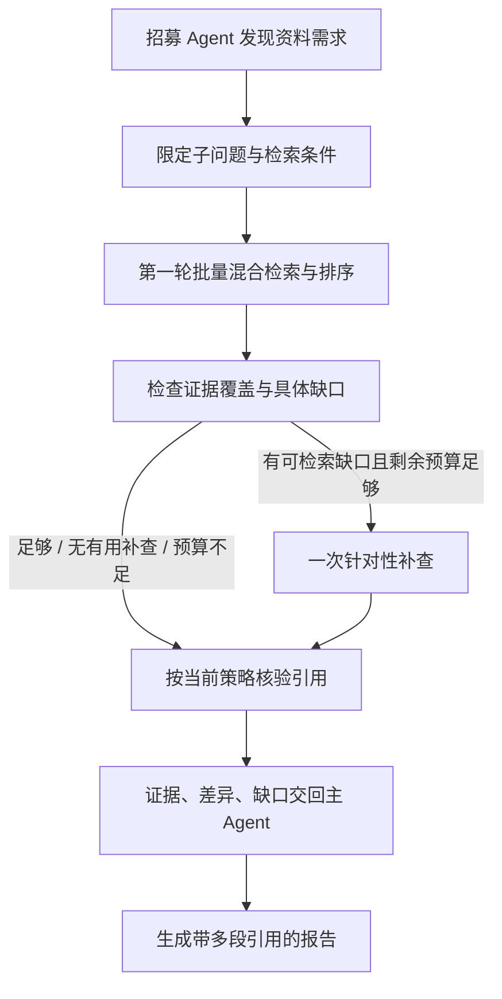

# 新版 RAG 落地候选方案

Status: approved-for-implementation
Updated: 2026-10-22

本方案汇总 grill-with-docs 中 Q1–Q9 的选择和已确认工程默认值。它不是已实现结果；正式规格和实施 issue 已发布。事实与研究依据见同目录 `research/`，原始选择见 `design-interview.md`。

## 目标、范围与可演示成果

面向 Agent 开发求职，按两三周组织工作。在现有足球招募 Agent 中完成资料综合调查：综合两三份资料，说明来源共同点、差异、样本适用范围和缺口，给每条关键结论附上能定位到原文的引用。

本轮输入是获准的结构化来源（首批 PLOS JATS/XML）和 Markdown/纯文本；保留方法资料与历史球员分析观点两路。资料按真实覆盖扩展，历史研究不升级成当前球员事实，匿名案例不建立具名球员观察。

交付包括可重跑的入库命令、有限补查流程、自动评测与实验报告、现有招募入口的集成演示，以及能解释失败原因的轨迹。PDF/OCR、通用上传问答产品、开放网页调查和模型训练不列入本轮关键路径。

## 一、入库与权威证据

1. **来源清单与通用解析。** 每份资料记录来源/许可、模型处理目的地、类别、作者、发布日期与原文可支持的样本范围。将 PLOS 中针对 Ronaldo/Messi 的特定段落分支改为通用 JATS 章节解析，身份关联由可追溯资料清单给出；Markdown 按语法结构解析，纯文本保留段落。取得资料、可提取正文和可用身份分别记录；原论文作者与项目摘要撰写者分开标注。
2. **规范化版本。** 保留原始载荷 hash、规范化规则版本、标题层级、段落/列表/获准且可读的表格、原始 locator。解析能力不扩大准入范围：现有来源排除的表格、图片、参考文献等仍执行排除；新内容范围须明确登记。图像表格或无法提取的公式不补写数值，记录缺口。相同正文和有效元数据的重复导入应是 no-op，变化才产生不可变新版本；原始载荷变化但规范化证据相同，只新增取得事件。
3. **模型 token 分块。** 使用实际 E5 tokenizer 对完整 `passage: `、元数据前缀、正文和特殊 token 一起计数，保证不超过 512 tokens；查询的 `query: ` 与正文也检查完整窗口，不静默截断主体或样本条件。优先保持章节和段落；过长段落按句子和 token 边界切分，只有必要的长段拆分加入小范围重叠。正文与检索前缀分开保存，引用始终指向原始规范化正文。
4. **SQLite + 派生索引。** 沿用 SQLite 权威原文/策略与 LanceDB 派生全文/向量索引，暂存构建、校验、再发布。元数据前缀先用标题、章节和明确样本信息；LLM 生成上下文、递归摘要树和知识图谱暂不进入关键路径。
5. **更新与撤回。** 支持显式导入/更新命令、幂等重跑和重建；策略更新以权威目录为准。来源撤回立即影响检索和引用使用；重复导入与内容等价重建不应因随机 generation ID 改变而虚假认定知识发生变化。

验收签名按组件记录：

| 组件 | 资格依赖 |
| --- | --- |
| 原文/策略 | 规范化章节及定位、来源/主体/样本元数据、有效许可与目的地、解析规则版本 |
| 混合检索 | 原文/策略签名、检索文本与分块区间、embedding/tokenizer artifact 与精度、全文索引与查询/融合规则、相关实现指纹 |
| 重排 | 混合检索签名、ranker artifact 或提示/网关模型标识、候选协议与相关性处理规则 |
| 资料调查及回答 | 所选检索/重排签名、查询规划/缺口检查/生成提示、预算与轮次、证据装配及多引用合同 |
| 语义验收 | 所评组件签名、冻结题包、评审提示与模型、受控样例及验收规则 |

generation ID 用于追溯；要复用内容等价重建的资格，必须校验规范化证据、有效策略和派生行/向量清单 hash 均相同。不能仅凭相同源文件宣称等价；不满足即重新评测。报告措辞提示变更影响调查/回答资格，不自动抹去独立检索组件的测量。

## 二、现有 Agent 内的有限资料调查

- 复用现有 LangGraph 与运行时上下文，增加明确的资料调查阶段；每次用户输入共用一份 SQLite 持久化调查/调用账本作为执行事实来源，记录原问题、子问题、查询、资料类别、核验主体/时间约束、各轮结果、引用、失败类别和待补缺口。LangGraph checkpoint 只保存稳定调查 ID、引用和必要摘要，不将暂态 PlanningRunState 作为第二份权威账本。
- 工程默认上限：首轮最多三个子查询，补查最多两个，全回合最多五个查询、两轮检索。子查询不能擅自扩大用户限定的主体与时间范围。相同查询、过滤条件、语料快照的重复请求复用成功结果；失败与零命中区分，完成未知的外呼不自动重发。
- 查询拆解/改写由当前网关模型给出有界结构化结果；缺口检查最多一次，结合已返回原文指出具体缺失信息并提出补查查询。子查询在显式调查阶段内部批量执行，不为每个子查询回到通用 Planner。资料正文作为不可信数据处理，工具权限、主体与时间约束由服务端字段控制。
- 资料阶段由一个预算所有者管理累计三十秒，包含内部查询规划、检索、重排、缺口检查与最终引用核验；主 Agent 最终报告生成另计。按实际阶段等待区间计时，并行批次不重复累加同一等待区间；子任务分配受限子预约，不能各自预约全部剩余额度。两轮、重试和恢复不重置预算，崩溃时未结算的调用预约按明确超时上限保守结算，不返还结果未知的等待额度。默认至少为最终原文核验保留三秒，其余阶段按剩余预算分配；模型/索引加载在服务准备阶段完成。
- 预算不足时停止补查，尝试核验已有引用后返回明确的部分证据与缺口；当前权限和引用有效性是使用前提。原生推理迟到时丢弃结果，不声称已经立即停止底层计算。
- 调整现有按候选姓名一次性去重、阶段动作菜单和单次重排预约，改按调查/轮次/查询/候选集合/模型配置持久记录。网关批量重排每轮至多一次、查询规划一次、缺口检查一次，因此资料阶段额外网关调用最多四次实际派发尝试；重试/输出修复也计入，SDK/传输层不隐藏重试。选本地重排时无需该两次网关排序调用。外呼前预约，结果先持久化再供图消费，恢复幂等读取；迟到响应只有在尝试版本和调查仍有效时才可提交。

报告实际使用资料前与交付前仍做廉价本地权限/引用状态检查，防止报告生成期间来源被撤回。阶段内的完整原文核验计入三十秒，交付投影不新增检索/推理；任一必要引用失效时抑制依赖它的主张，不仅删除引文标记。

最终状态区分：有足够证据、部分证据、语料未覆盖、成功零命中、服务不可用、预算耗尽、用户取消。上述状态与每个子问题/主体关联，不能用一份最后结果覆盖整轮调查。

## 三、检索与重排实验

先固定同一批原文和问题，再比较：

| 对照 | 用途 |
| --- | --- |
| 全文检索 | 精确词项基线 |
| 本地 E5 向量检索 | 语义与中英查询基线 |
| 两路检索 + RRF | 现有混合基线 |
| 混合 + 一个本地 Cross-Encoder | 检验专用重排的相关性、耗时与内存 |
| 混合 + 当前网关模型重排 | 检验生成式排序的收益、耗时和调用用量 |

保留原有每路候选上限作为初始配置；先比较相同候选池的排序，再单独实验上下文/邻块扩展。不同查询各自融合候选，按原文引用去重并保留多查询归属；每轮按查询轮转从各自前列选入，最多十二个不同候选，剩余名额按固定融合规则补齐。排序任务保留每个查询的相关性与顺序：网关一次批量返回完整的查询—候选排序，本地模型批量评分查询—段落对；不把多个问题揉成一个无法区分归属的总分。协议检查遗漏/重复/未知 ID，使用短候选 ID 并显式限制输出。最终先按子问题覆盖轮转选片段，默认最多八块并受主 Agent 上下文预算约束，来源重复上限与邻块扩展在开发集单独实验。

本地候选从已有 ONNX/Transformers.js 路径中选择一个，锁定模型 revision、精度和 tokenizer；按查询与段落的合计 token 窗口适配，先预加载与预热。E5 能容纳的块不自动视为能放进重排窗口；过长配对须显式采用受限窗口并记录覆盖/计分规则，或标记该候选不适用，不能静默截掉段尾后当作完整阅读。相关性 logit 用于排序，不直接当置信度或擅自设置拒绝阈值。中文问题/英文正文效果及冷/热启动、峰值内存、取消和迟到行为均需实测。

运行默认方案由开发集效果与成本选择，再用冻结验证集验收。候选无收益时允许保留混合或网关基线；实验结论如实保存。小语料不以 ANN/HNSW 为目标，后续仅在规模与实测延迟需要时单独比较。

## 四、结论与多个精确引用

每条关键主张保存文本、属于来源陈述还是跨资料归纳、支撑引用数组和必要限制。一个引用包含不可变原文版本、章节、区间与 hash；多个引用可以共同支撑一条归纳，不要求每个引用单独证明整句。引用集合缺少必要部分时不得保留原有完整归纳；来源有冲突或限制时在主张中保留，不能仅将相反引文并列后忽略分歧。

报告投影按给出的精确引用解析，不再用文档 ID 随机取首个片段。模型正文只能引用本次已核验和获准展示的证据。保留项目作者摘要与论文原文的区别，以及方法资料、历史分析和第一方观察的类别；分歧可并列解释，不让模型合成未经来源支持的新数值或当前球员结论。

引用 ID/区间/hash/展示权限由程序校验；主张是否被原文语义支持由自动评测估计，二者不混称同一种准确率。

## 五、全自动评测与参考证据

### 固定题包

- 先扩充真实获准语料，再自动生成带原文区间、参考事实、参考答案、可答范围的问题。目标约一百题，覆盖单处事实、跨资料综合、主体/赛季干扰、证据不足与冲突处理；数量服从真实资料质量，不以同事实改写凑知识覆盖。
- 参考来源是规范化原文版本及精确区间，不绑定某一切块方案。允许多个支持路径，记录模型生成/核验来源为 `synthetic_ai_checked`。程序检查引文逐字存在，隔离上下文的当前模型检查语义支持；争议或不完整记录在冻结前隔离。
- 默认以至少八十道合格问题、四十个独立事实组、六个独立文章来源作为本轮试点基准目标；不足时报告题包未就绪，不能空跑后自动验收。项目作者摘要与其原论文按同一底层来源计数。该规模是项目范围约定，不是统计充分性证明。
- 按同事实、近重复问题及重叠支持区间分组，以事实组约 60:40 划分开发与冻结验证。跨资料问题共享支持事实时需一起分组；连通组过大时扩充新事实，不拆散重复事实以凑比例。任务类型可以分层覆盖两侧，不把“同一题型”本身误判为泄漏。
- 原文可同时在待检索库与库内问答基准中出现；冻结问题/参考答案不得进入检索索引、模型训练或开发提示样例。验证题不用于调参数；下一轮使用已暴露失败题调优时需形成新版本留出题。此实验不宣称未知来源泛化。
- 未覆盖主体、明确不匹配的样本范围等标签可由登记元数据验证并保存判定依据。自然语言无答案标签分为限定文档/上下文不足与准入语料快照内估计不足：前者核验完整限定正文，后者必须记录跨该快照的证据搜集/核验结果及 AI 估计来源；仅一次检索失败或某段未提及不能建立全库无答案标签。无法自动建立范围与依据的负例在冻结前隔离，不能把“当前资料未支持”扩大成世界事实。

### 三层运行

1. **检索单独评测。** 固定问题直接调用知识接口，映射原文参考区间到本次分块。每题有若干必要事实组（AND）；每组可有多个足够的支持路径（OR），每条路径包含一个或多个必须共同取得的原文区间（AND）。前 k 个块在同一原文版本上形成的区间并集完整覆盖某条路径的全部非空白内容位置，才算该事实组找齐；仅忽略规范化分段带来的纯空白间隙，局部内容重叠不当作完整支持。主指标为必要事实组覆盖比例与所有必要组均齐备的比例，在不同分块实验间保持参考区间不变。辅助块级 qrels 由各参考区间的最小完整覆盖块集合确定（可由单块完整包含，也可跨块；相同覆盖按稳定块顺序确定），对已标注替代路径的映射取并集，并保存算法版本。其 Recall@k、Hit@k、MRR 反映已知映射块的排序，不把只命中一个局部块视作全部事实已齐，也不用其分数单独比较不同分块的证据完整性。所有指标只覆盖已标注参考，不声称穷尽相关证据。没有正向支持标签的拒答题，其 Recall/MRR 记 N/A 并报告数量，仍进入拒答/误接受评测；有正向标签但检索故障则记零召回并另记故障。无法从已发布索引完整映射某个正向参考区间是索引/标注完整性错误，题包或索引不能取得可评测资格，不能将其静默改成 N/A。
2. **给定参考证据的生成诊断。** 直接提供参考原文，观察模型在证据已齐时是否仍误读、遗漏或错误拒答。该组明确标为 oracle/reference-context，不计作实际检索效果。
3. **真实资料调查与业务入口。** 固定问题跑完整两轮服务，另外用一组有界案件通过普通应用装配/JSON 与 SSE 入口，验证触发、引用、恢复、取消、故障、时限及报告投影。候选数据可用标明来源的冻结快照，知识证据使用真实获准语料；不拿仅直接 reader 的运行证明业务集成已完成。

隔离检索方案的对照时固定查询和候选池；比较单轮/两轮时固定同一检索策略，再记录补查的证据新增量、答案变化与额外成本，避免一次改多项却把收益归因给其中一项。

### 同模型评审

题目生成、参考核验、答案评审均走当前已配置网关模型，角色及上下文隔离。答案评审不看方案名称、基线/新方案身份或预期实验胜者；同时检查实际引用原文、参考事实、回答主张与拒答范围，并输出对应的原文依据。

语义质量采用两个不同职责的评审调用：一份按主张检查支持与覆盖，另一份重点检查矛盾、主体与时间范围。两者一致支持才通过，一致不支持记失败，分歧或任一不确定记未决；确定性引用/权限/范围违规可直接失败。不给冻结未决题强制多数裁决，不从分母剔除。

同模型重复调用仍可能共享错误，报告称模型评审估计。增加自动可核验的正负控制样例（如正确引文、与原文明显矛盾的年份/数字、换引用、缺少引用），独立于主题包记录。默认冻结至少十二条明确受支持的正控制与十二条可程序验证的错误控制，语义含糊的控制在冻结前隔离；评审需在错误控制上无错误放行，并在正控制上至少 90% 一致通过。控制规则在验证前锁定，若不满足，整组语义质量资格记 `judge_unreliable`/未决，主题包分数仅作诊断，不能发布接受记录。控制只测受控错误敏感度，不冒充真实用户题或人类校准。只会拒答的方案还会在可答问题覆盖与错误拒答指标上暴露问题。

### 运行、预算和资格

评测产物保存题包/原文/策略/索引内容与实现版本、embedding/reranker/网关模型标识、提示版本、原始结果、引用、各项分数、未决原因、耗时和实际可得 token。缺失 token 不补算费用；同一模型名不能保证供应方权重未变，记录能取得的服务端版本信息与运行时间。

提供快速开发子集与完整验证命令；先生成可审计运行清单，列出各对照、层次、问题 ID、资料调查内部实际调用、主 Agent 规划/报告、oracle、两次评审、控制和允许重试的最坏调用与 token 数。模型调用采用硬预算、有限并发与带版本缓存。候选默认快速运行最多一百次网关调用，完整工作流最多一千次；该上限覆盖本次清单中的数据准备和全部实验阶段，不对每个子步骤重新发一份额度。如清单上界超限，在派发前停止并展示所需额度，不能自动缩减冻结题、删对照或少跑评审。预算变更必须在运行前显式配置，执行中断保留已完成产物但不产生接受记录；未知网关单价时不把调用/token 上限称作人民币费用保证。

可复用签名完全匹配的确定性结果及参考生成产物。主要模型行为对照默认在同一验证窗口中交错运行基线与候选，不能为省调用混用不同时窗的网关行为并宣称严格同条件；明确复用旧模型输出的辅助实验须单独标注且不能替代该主对照。

验收策略以版本文件管理，并在首次打开冻结验证结果前锁定。候选工程默认：确定性权限/主体/引用/轮次违规为零；控制可靠性门槛需通过；任一冻结语义项未决阻止相应质量资格。题目处置标签为可答、部分可答、应拒答：支持回答比例以可答/部分可答题为分母（完整错误拒答、不完整执行均不算通过）且至少 90%；参考事实覆盖先逐题计算已覆盖必要事实/可回答必要事实，再对可答/部分可答题做宏平均，至少 85%；拒答处理以部分可答/应拒答题为分母，至少 90%。三个分母均保留失败、未决和超时题，N/A 只用于确实没有相应标注的指标并报告数量。支持率检查是否存在未获支持主张，覆盖率另检查是否答全；不能用短答或全部拒答抬高通过率。这些是拟议项目目标，不是行业标准或已经达到的成绩，不能看完验证结果再降低目标。

固定基线为同一新语料、同一 token 分块与证据合同下的单轮混合检索、无专用重排、相同网关生成模型；不以旧版字符切块或单引用缺陷人为压低它。查询、重排和补查分别做单项对照。候选达到质量下限后，默认非退步合同为：总体及有样本的主任务类别上，支持回答比例、宏平均事实覆盖、拒答处理均不低于固定基线；新增确定性关键违规为零。逐题退步和进步均公开，但普通个别题的退步不等同整体资格失败；关键主体/时间/权限/引用违规单独阻止资格。质量相同再比较延迟、调用和内存。样本较小，报告逐题/事实组变化及不确定性，不把小幅百分比变化称为显著提升；无可靠收益时保留更简单的合格基线。

合格的完整运行可由发布命令自动生成对应组件的验收记录，后续资格依赖完整签名匹配。资料、策略、提示或模型配置变化按组件依赖重新评测；不完整、失败或未决的新候选不会获得资格。新版本构建失败可继续使用当前策略允许且资格签名仍匹配的旧版本；来源撤回和展示限制立即生效，不能为保持旧资格恢复被撤回的策略。

## 六、交付顺序与面试证据

| 阶段 | 交付及可演示证据 |
| --- | --- |
| 第一周 | 通用结构化/Markdown 入库、token 校验、幂等版本与原文引用；初批真实语料、自动题包和开发/验证分组报告；先通过一个真实应用入口打通窄调查与多引用合同 |
| 第二周 | 全文/向量/混合与本地/网关重排对照；基于原文区间的评测；同模型语义评审与受控错误样例；调查账本和两轮预算的关键路径 |
| 第三周 | 完成两轮调查、三十秒预算、故障恢复、JSON/SSE 一致性；冻结验证、对照报告、演示脚本和面试追问说明 |

两三周是组织范围，不是提前承诺所有候选有效。第三周优先完成调查闭环与证据报告，所有具体改进必须有对应运行产物。

面试材料围绕四个问题组织：为什么这样解析和切块；混合检索与重排各改善什么；Agent 为什么补查及如何停止；自动评测能证明什么、哪些结论仍受同模型评审与合成数据限制。交付保留可运行命令、架构图、失败案例和可追溯实验配置。
