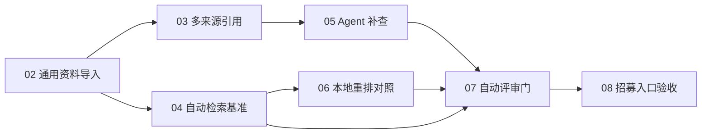

# 新版 RAG 已批准票据拆分

Status: approved-and-published
Updated: 2026-10-22

依据：[已确认规格](spec.md)。现有父 issue [01：新版 RAG：自动化资料调查与评测](issues/01-automated-retrieval-investigation-and-evaluation.md)保持原样；七张子 issue 已按依赖顺序创建为 02–08。

每张票都描述可单独验证的纵向切片。依赖图如下：

02 完成后，03 和 04 可并行；03 完成后可启动 05；04 完成后可启动 06；04–06 完成后启动 07，最后完成 08。详细交付与验收条件以单票文件为准。
