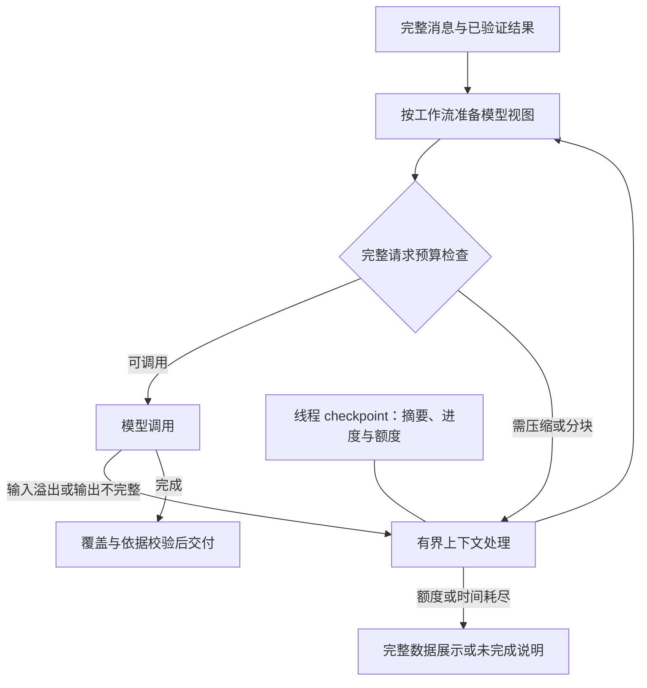

# 运行时上下文管理实施计划

Status: resolved

完整方案已于 2026-11-08 在 Q16 获得用户确认，设计讨论完成。正式规格已整理为 ready-for-agent；上下文管理功能尚未实现。

正式规格：[spec.md](spec.md)。技术细则：[design.md](design.md)。架构决定：[ADR-0012](../../docs/adr/0012-model-input-budget-and-persisted-evidence.md)。原始讨论：[discussion.md](discussion.md)。资料与独立判断：[research.md](research.md)。

## 目标

为 TactiScout 每次实际模型调用准备受预算约束的工作上下文，自动处理长历史、结构化大结果和单条超长用户输入。保留完整原始记录和已验证快照，支持正常重启续接、明确限额和真实的完成状态。

Store / 持久化票据 01–07 已完成。本功能接入已具备的线程 checkpoint 和恢复基线，使用线程内辅助元数据，不将压缩摘要写入跨线程身份 Store；实施前仍核对最终 schema 和测试 seam。

## 已确认的决定

| 问题 | 决定 |
| --- | --- |
| Q1 | 覆盖请求理解、lookup 工具循环、执行 / 保存结果解释，以及本功能新增的模型调用；包含预检和溢出恢复。 |
| Q2 | 管理模型工作上下文，保留完整消息 / 工具原文和已验证 workflow snapshot；checkpoint 清理 / TTL 另立计划。 |
| Q3 | 允许有上限的额外调用自动处理大结果，以完成原任务为目标；不能完成时明确说明。 |
| Q4 | 显式预算配置优先；可信标准端点可用已知模型资料，未知模型 / 网关窗口必须配置。 |
| Q5 | 结构化证据精确选择字段 / 记录、分块或按需读取；文字历史和过程说明可摘要。 |
| Q6 | 本轮用户输入超限时自动触发 compaction。 |
| Q7 | 优先压缩旧内容，本轮消息能装下则保持原文；单条自身超限则自动分块提取任务 / 条件和原文定位。 |
| Q8 | 压缩结果、覆盖范围、原文引用和版本随线程 checkpoint 保存，校验后复用。 |
| Q9 | 保留现有 StateGraph 和业务节点，使用共享预算 / compaction / 恢复能力。 |
| Q10 | 可用输入预算的 80% 软触发、60% 目标作为可配置初始值，每次发送前检查硬上限。 |
| Q11 | 压缩默认沿用当前任务模型 / 端点，允许显式配置独立压缩模型及其预算。 |
| Q12 | 每请求默认最多 6 次额外模型调用 / 120 秒累计活动处理时间，任一先到即停；失败 / 重试计数，恢复不清零，原重试 / 搜索上限继续生效。 |
| Q13 | 完整数据已有但解释未完成时，程序展示完整数据和来源并标明解释未完成；理解 / 数据不完整时不生成整体比较或排名。 |
| Q14 | 用户明确要求继续可追加新的有界额度，从断点和已有数据续接，历史消耗保留；普通恢复 / 重启不追加。 |
| Q15 | 首版由程序按工作流选择、分块和回读证据，lookup 保留既有受控搜索；不增加模型可自由探索上下文的通用检索工具。 |

80% / 60% 与 6 次 / 120 秒是可调初始值，不是已证明的最佳值，也不构成任意长任务必定自动完成的承诺。

## 执行结构

基础指令 / schema 无法装入窗口时，明确报告配置问题。鉴权、配额等错误沿用原分类，不被伪装成可压缩的上下文问题。

## 当前入口及处理方向

| 入口 | 当前输入 | 计划处理 |
| --- | --- | --- |
| 请求理解 | 当前消息、焦点、别名、active workflow 条件等结构化投影 | 仅选择相关引用；超长原文自动分块并合并核对全部任务条件。 |
| Lookup | 当前轮消息与工具调用 / 结果 | 保持 tool call / result 配对和精确来源 ID，对大结果做程序驱动的证据选择及分块。 |
| 执行 / 保存结果解释 | 当前用户消息与完整 resultJson | 从完整已验证快照准备证据批次，检查全部所需记录 / 字段覆盖，必要时分批解释。 |
| 新增压缩 / 分块调用 | 程序选择的旧文字或当前长输入批次 | 同样检查完整输入预算，使用共享额外额度，不能递归进行无界压缩。 |

实施前重新核对这些入口和 Store 最终 schema；讨论时的行号只作定位线索。

## 关键工程规则

- 完整请求计数包含系统指令、消息、工具 / 结构化输出 schema 和协议开销；考虑输出上限与误差余量。实际 provider 仍可能报告溢出，因此保留有界恢复。
- 每种用途须解析出有限、实际传给 API 的输出额度；未知默认额度不能视为零。窗口语义与计数余量通过配置 / 适配器明确。
- 模型输入投影字段缺席不代表源数据缺失；身份、赛季、范围、排名、null / unavailable / not-queried 含义保持。
- 全部确认参与者和全部返回候选仍需覆盖。摘要不确认身份、不创造 Store 记忆，也不替代精确数值证据。
- 原文、精确约束和来源引用保留；重复摘要可从原文重建。辅助缓存过期时重建，主 State 真正不兼容时遵守持久化方案的兼容性规则。
- 在 checkpoint 边界保守记账；无法确认完成的已开始调用消耗不能因恢复而消失。允许只读调用重复，不承诺 exactly-once。
- 新增的 N 次批次解释全部计入额外额度，最终一次原业务回答沿用原调用预算；不调用最终模型时，也不能把一批改为免计。分类和消耗随恢复保持。
- 区分输入溢出、输出截断、条件歧义、数据未完成和解释未完成。每类都有明确退出 / 恢复行为。
- 分别记录模型实际收到的证据和确定性展示读取的证据，更新现有 eval collector，禁止将整个存储快照冒称为模型已看到的内容。
- 只有额度耗尽且原请求进度仍有效时，“继续”才追加 grant；配置、鉴权、契约错误或条件歧义不能靠继续直接绕过。

详细字段、失效条件、失败交付与验收规则见 [spec.md](spec.md)。这些规则按已接受边界具体化，不扩大球员数据、身份或来源的业务能力。

## 实施顺序

| 阶段 | 主要交付与检查 | 依赖 |
| --- | --- | --- |
| 准入 | 基于已完成的 Store / 持久化实现，核对最终 State / memory schema、恢复行为和 Dev Server 测试 seam。 | 持久化票据 01–07 已 resolved |
| 01 预算基础 | 模型能力与配置解析、完整请求计数、输出上限、80% / 60% / 硬检查；为 fake model 注入明确预算。 | 准入 |
| 02 可恢复处理状态 | 线程内摘要 / 证据引用 / 进度、grant 与预留 / 消耗记账、缓存版本失效和正常重启恢复。 | 01 |
| 03 自动文字处理 | 旧文字 compaction、超长本轮输入分块、任务 / 条件合并校验与现有澄清衔接。 | 01、02 |
| 04 工作流证据投影 | 接入全部入口；程序安排字段 / 记录选择、分批和回读；保持身份与 lookup 协议、完整结果快照和 saved reuse。 | 01–03 |
| 05 恢复和交付 | 实际 overflow / 输出截断恢复、无进展退出、确定性完整数据展示、额度耗尽与显式继续 grant。 | 01–04 |
| 06 完整验收 | 模型证据 / 渲染证据观测、续接型评测、相关回归、Dev Server 临时存储重启验收和配置 / 使用说明。 | 01–05 |

各阶段同步补有意义的边界测试；观测所需数据契约从基础阶段就定义。逐项设计收尾后，实施可按上述阶段拆成独立本地票据，不将本计划的设计完成误标成代码已实现。

## 验收重点

1. 小请求行为保持，无需处理时没有额外摘要调用。
2. 长历史、长别名、首条超长用户输入和大工具结果均能触发正确处理，辅助调用自身也装得下。
3. 多次压缩后仍保留早期精确条件、来源范围、参与者、候选顺序与缺失值语义。
4. 实际 overflow 和输出截断不被当作完成；失败 / 重试 / 重启均不绕开额度。
5. 完整数据与未完成解释能准确交付；显式继续可复用数据和断点，不重复查询或排名。
6. 源内容 / 快照 / 缓存版本变化能正确失效，正常重启可恢复；不使用真实用户持久化文件做破坏性测试。
7. 模型证据、确定性渲染依据与原始存储区分，现有工作流和相关固定证据回归保持。

完整验收矩阵见 spec 第 9 节。历史普通用例的 token usage 不证明压力场景已通过；设计阶段没有运行实现测试或 live 评测。

## Q16：设计确认与交接

用户于 2026-11-08 回复“同意”，确认完整计划和技术方案，随后调用 to-spec。Q1–Q15 及整体测试入口均已确认，设计讨论标记为 resolved。

2026-11-13 收尾：运行时上下文管理票据 01–11 均已 resolved。最终提交为 `ba6372c`；类型检查、全仓库 Ultracite 和最终全量测试（141 个文件 / 539 个用例）通过。续接使用固定模型 / provider 回归验证；未运行 live semantic judge，不承诺对任意自然语言摘要的普遍语义保真。
