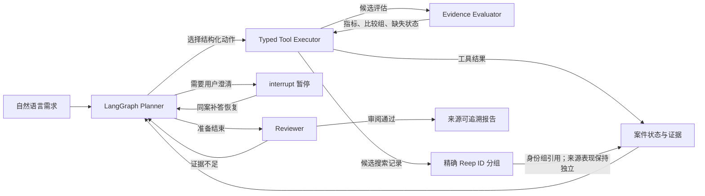

# TactiScout

**用自然语言启动的男足引援调查 Agent。** 用户描述球队的阵容问题，TactiScout 会调查可用球员数据、在关键条件未明确时追问、比较已评估候选的能力证据，再由 Reviewer 检查依据和数据缺口，最后给出可追溯的后续考察线索。

TactiScout 是一个全 TypeScript 的作品集项目，重点展示 LangGraph 如何管理真实的多轮调查、工具编排和证据约束，而不只是把模型包在聊天界面里。

## 项目亮点

- **由图控制的调查循环：** Planner 根据状态决定查询数据、检索方法资料、追问用户、扩展候选范围或结束；LangGraph 保存案件状态并把工具结果送回下一次决策。
- **中途追问与恢复：** 需要角色、位置或范围确认时，图通过 `interrupt` 暂停；用户补答后继续同一案件，而不是从头分析。
- **工具证据与确定性计算分工：** Agent 选择调查动作；typed tool executor 负责分发，独立的证据 evaluator 负责加载合格候选、构造同位置/赛事/赛季比较组并计算可观测指标。LangGraph 保留案件策略与状态迁移；缺失指标不会按零处理，也不会被相近字段冒充。
- **停止会传到正在执行的工具：** 用户取消会通知候选/球队查询、Understat/ASA/mosaic 来源请求、RAG 检索和候选评估；共享缓存请求只在最后一个调用者离开时中止。不可中断的本地库调用结束后会丢弃结果，不再开始下一项调查动作。
- **审阅与可追溯报告：** Reviewer 检查结论是否引用已评估候选的证据。报告展示来源、样本、覆盖情况和限制；进度事件可以和实际工具轨迹对照。
- **完整回归门：** CI 运行确定性 LangGraph/Harness、API 和数据适配器测试，再构建 API 与 Web；测试使用固定夹具，不依赖在线球员数据或云模型。
- **来源处理边界在运行时执行：** FBref 与 FPL 在 checkpoint、候选读取和 Planner 之前被拒绝；StatsBomb 必须显式确认协议并使用本机模型；权限尚未核实的 Understat、ASA 与 mosaic 只允许使用本机回环模型。打开网页、个人非商业用途或自设环境变量都不会被当作来源许可。
- **精确身份分组、证据按来源保留：** 只有 Reep 唯一有效 ID 会把多条来源记录归为同一候选；指标与样本仍按来源独立评估，Reviewer 会阻止同一已确认身份重复推荐。
- **本地优先的运行时：** Ollama 可作为 OpenAI-compatible 模型服务；LangGraph 案件 checkpoint 存在本地 SQLite，计划和报告快照存在浏览器 `localStorage`。



LangGraph 在这里承担持久案件状态、条件路由、工具循环、用户中断/恢复和 Reviewer 回退。阶段内的 Planner 仍由模型决定调查动作；框架负责控制模型决策进入哪些合法状态，并保留可观测运行轨迹。更多设计见 [架构说明](docs/architecture.md) 和 [受约束调查阶段 ADR](docs/adr/0005-constrained-langgraph-investigation-stages.md)。

候选证据计算是独立的确定性模块：它只评估本轮已发现且仍符合需求条件的来源记录，并按相同位置、赛事和赛季形成 peer group。模型不能改写原始指标、缺失状态或样本门槛；图根据工具结果继续调查、追问或结束。

## 技术栈

| 层 | 技术 | 职责 |
|---|---|---|
| Web | React、TypeScript、Vite | 对话工作台、调查进度、候选比较与报告 |
| API | Fastify、Zod | 案件接口、请求校验、共享契约 |
| Agent | LangGraph `StateGraph`、`@langchain/openai` | 多轮状态、工具调用、条件路由、interrupt 与 SQLite checkpoint |
| 数据与 RAG | 自建版本化快照、LanceDB、Transformers.js | 来源追溯、确定性指标、许可门控和本地向量检索 |

## 快速开始

### 只浏览录制运行

需要 Node.js 22.13+ 和 pnpm，无需 Ollama、API 或数据服务。在仓库根目录安装依赖并只启动 Web：

```bash
pnpm install
pnpm dev:web
```

打开 <http://127.0.0.1:5173/showcase>。页面展示脱敏的历史 Harness 运行，不会发起新的 Agent 调查。

### 启动交互 Agent

需要 Node.js 22.13+、pnpm 和 Ollama。默认数据模式是标注清楚的 `demo`；Ollama 提供兼容 OpenAI 的本地模型接口。

```bash
pnpm install
if [ ! -f .env ]; then cp .env.example .env; fi
ollama run qwen3.5:9b
```

在 `.env` 中设置：

```env
TACTISCOUT_DATA_MODE=demo
OPENAI_API_KEY=ollama
OPENAI_MODEL=qwen3.5:9b
OPENAI_BASE_URL=http://127.0.0.1:11434/v1/
OPENAI_REASONING_EFFORT=none
```

在两个终端分别启动 API 和 Web：

```bash
pnpm dev
```

```bash
pnpm dev:web
```

打开 <http://127.0.0.1:5173/>。模型服务未配置时，对话 API 会返回明确的 `503`，不会把机械筛选伪装成 Agent 运行。更多模型与数据配置见 [数据来源与配置边界](docs/data-sources.md)。

给面试官或第一次体验的评审者：按[面试演示路线](docs/demo-walkthrough.md)配置本地模型、观察多轮追问与同案恢复，并用 Harness 命令核验一次真实端到端运行。

不启动 API/模型时也可以先看 [录制运行展示](docs/demo-walkthrough.md#免模型查看记录)：从首页进入 `/showcase`，浏览真实历史 Harness 轨迹、证据摘要与明确的数据边界。它是静态记录，不会启动新调查或展示完整对话。

## 当前数据范围

交互演示的当前赛季候选发现使用单一 Understat 路线；`demo` 是离线演示回退，`curated` 是历史复现数据。其它 provider 和组合路线留作独立实验，不构成另一个默认候选池。每条记录仍保留来源身份、赛事/赛季、字段口径和缺失状态；不同来源不会因姓名或数值相似而合并成一份球员档案。

| 模式 | 定位与边界 |
|---|---|
| `understat` | 当前互动演示的单一当前赛季来源，覆盖五大联赛表现记录；页面没有年龄，不是完整注册名单，自动采集、留存、模型/RAG 处理和公开展示权限尚未核实。 |
| `demo` | 默认离线演示回退，可快速运行对话链路；使用虚构数据，不代表真实球员市场。 |
| `curated` | TactiScout 从 Wyscout Open Data 构建的 2017/18 历史快照；适合复现历史表现，不是现役候选池。 |
| `mosaic` | 仅供开发和历史实验的多来源组合路线；不是当前互动演示的权威候选池，跨赛事结果不构成统一排名，来源使用权限也未完全核实。 |

各 provider 的实际获取方式、当前准入状态和本地/模型/公开展示边界见 [数据来源说明](docs/data-sources.md)。

Understat、ASA 与 mosaic 的运行时会拒绝远程模型地址，并在读取案件或候选数据前返回 HTTP 503；配置本机 Ollama 只避免向云端发送数据，不代表来源方已授权采集、留存、模型处理或公开展示。

2026-10-11 的一次本地 Understat 顺序读取获得 2,164 条 2026/27 五大联赛球员赛季表现记录；年龄字段不可用，来源的自动采集、留存、模型/RAG 与公开展示权限也尚未核实。这只是当日可读样本，不代表完整名单或推荐质量。

2026-10-09 对 NCAA 2026 男足统计榜与 Football Web Pages API 的新路线调查都判为暂不准入；覆盖增量和书面授权下一步见 [来源调查记录](.scratch/tactiscout-mvp/issues/118-screen-new-authorized-source-leads.md)。

## 端到端评测

```bash
pnpm test
pnpm build
pnpm build:web
mkdir -p .data/evaluations
TACTISCOUT_DATA_MODE=understat pnpm eval:local-agent -- \
  --scenario understat-five-league-xg-creation \
  --summary-output .data/evaluations/understat-demo-summary.json
```

摘要导出拒绝覆盖已有文件；重复运行时请换一个输出文件名。

最近一次完整链路验收于 2026-10-12 使用 Understat 当前五大联赛表现样本和本机 Qwen 3.5 9B：LangGraph 完成方法检索、候选搜索与分批评估、Reviewer 和报告，**31/31 Harness 行为检查通过**，3 次模型请求、6 次工具调用、29 条进度事件，用时 53.195 秒；服务端报告输入/输出/总计 8,688/746/9,434 tokens。候选查询匹配 650 条来源记录，评估 20 条；220/340 个预期指标值可用，但 20 条均为低分钟样本。方法语料返回 2 个片段，球员报告语料 0 命中，报告列出 3 条候选线索。去标识化摘要保存在 Git 忽略目录 `.data/evaluations/understat-identity-free-summary-verified-2026-10-12.json`。单次通过只验证本轮的工具与证据约束，不代表长期可靠性、完整转会市场或推荐排序质量。**Understat 自动采集、本地留存、模型/RAG 处理和公开展示权限尚未核实；该来源没有年龄字段。**更早的 FPL 与 mosaic 运行只作为历史工程记录，完整历史见 [Harness 记录](.scratch/tactiscout-mvp/issues/14-agent-harness-evaluation-suite.md)与[数据来源说明](docs/data-sources.md)。

需要保存新的 Harness 验收证据时，使用 `--summary-output <path>` 写入仅含聚合计数的本地文件；例如 `TACTISCOUT_DATA_MODE=understat pnpm eval:local-agent -- --scenario understat-five-league-xg-creation --summary-output .data/evaluations/understat-summary.json`。该模式不打印详细 JSON、trace 或进度载荷，文件以仅本机用户可读方式新建并拒绝覆盖；候选身份、需求文本、报告正文和模型端点不会写进摘要。详见[评测说明](docs/evaluation.md#身份自由的-harness-摘要)。

Harness 验证工具编排、同案恢复、位置/证据边界和进度轨迹；**球员推荐排序质量尚未评估**，因为项目没有可信球探排序标签。单次完整链路通过也不证明长期可靠性、来源授权或完整市场覆盖。命令选项与方法 RAG 基准见 [评测说明](docs/evaluation.md)。

## 核心机制消融

这些实验都在固定场景中对照**同一张 LangGraph**的某项能力开关，检查变化实际经过哪些节点并进入什么报告；结果来自本机 Qwen 3.5 9B 的有限复跑，不构成统计功效，也不是推荐准确率评测。

- **动态调查规划：** 两个冻结场景各三组配对，12 次整图运行均通过 Harness。带完整 provider 用量的重跑显示，动态臂每次整图平均使用 9,211/12,263 Planner tokens，单页固定臂为 1,115/6,676（巴萨/拜仁；输入、输出、合计分别列于展示页）。动态臂在这两个案例中调用更多 Planner 并使用更多 tokens；token 不是金额成本，且没有球探标签判断哪种策略推荐更准确。[协议与结果](docs/evaluation.md#动态调查规划消融)
- **追问策略：** 拜仁缺少关键职责时，正常臂 3/3 次完成两次匹配追问并恢复同案（各 29/29 检查通过）；禁问臂 3/3 次在调查后安全暂停，没有收到答案或生成报告（各 7/7）。清晰的巴萨 U23 中场场景中，两臂均 3/3 次无追问地完成调查（各 31/31）。对照同时改变追问权限和答案可用性，不能单独归因于问题措辞，也不评估推荐质量。[协议与结果](docs/evaluation.md#追问策略消融) · [issue 138](.scratch/tactiscout-mvp/issues/138-ask-user-policy-ablation.md)
- **证据 Reviewer：** 拜仁场景中，完整 Reviewer 3/3 次通过 29/29 检查并各修复一条证据引用；旁路臂每次只未通过“需求能力有依据”检查，候选集合与工具轨迹相同。清晰的巴萨中场场景中，两臂 3/3 次都通过 30/30 检查，Reviewer 没有需要修复的内容。这表明它在特定场景修复了引用缺口，也可能不改变本来已通过的报告；不代表普遍审核效果或推荐质量。[协议与结果](docs/evaluation.md#证据复核门消融) · [issue 132](.scratch/tactiscout-mvp/issues/132-controlled-evidence-review-ablation.md) · [issue 134](.scratch/tactiscout-mvp/issues/134-cross-scenario-reviewer-ablation.md)
- **方法 RAG：** 早期整图实验观察到来源约束的检索内容进入报告；同快照重跑中两臂均未通过相同的两项 Harness 检查，不能据此推断决策路径影响。另有来源级跨语言诊断：英文译问把固定留出集的可回答证据覆盖从 1/3 提至 3/3；样本只有 12 个项目作者标注意图，译文未经独立双语审校，未启用线上翻译，也不代表推荐质量。[整图消融](docs/evaluation.md#方法-rag-agent-整图消融) · [跨语言检索结果](docs/evaluation.md#中文-query-与英文论文的-v5-跨语言诊断)
- **历史报告旁注：** Understat 场景三组配对，两臂各 3/3 通过。开启臂为 5 名候选找到 6 条 Wyscout 2017/18 历史样本；三组的当前证据、推荐顺序和工具轨迹完全一致。这验证历史样本只作可追溯旁注，不改变当前表现排序；它不代表现役能力。[协议与结果](docs/evaluation.md#understat-历史档案旁注消融)

**能力证据评估器：** Qwen 3.5 9B 在固定 Wyscout 2017/18 快照上完成三组配对。开启臂 3/3 次通过 31/31 Harness，每次评估 20 人并返回 194 个指标值；两个与需求直接相关的指标均可见，报告有 3 名推荐和 6 条证据引用。屏蔽臂 3/3 次都通过“无评估证据”控制契约，没有指标值、能力覆盖判断、推荐或证据引用；普通 Harness 的两项能力覆盖检查按设计失败。每对下游 Planner/工具轨迹相同。这证明冻结案例里的评估证据传入报告并支持有依据的推荐，不证明推荐质量或一般可靠性；排序质量仍为 `not_evaluable`。[协议与结果](docs/evaluation.md#能力证据评估器整图消融) · [issue 153](.scratch/tactiscout-mvp/issues/153-ablate-recruitment-evidence-evaluator.md)

项目还提供离线短名单质量评测器和本地盲评链路：`/review` 收集匿名独立评分，`/adjudicate` 在全部评分锁定后展示裁决界面、载入答案键并计算逐 query nDCG@5。评测输入使用匿名卡 ID，并把数值等级一致与 unknown 配对分开报告。本机已从真实 Harness 运行生成两份 Wyscout 历史盲评包：一份是 29 张匿名卡的凯恩接班人样本；另一份是 20 张匿名卡的 U23 前锋进攻地面对抗样本，只要求评审两项与来源事件直接对应的指标，系统实际报告排名为 3 人。两份包和答案键均留在 Git 忽略的 `.data/` 目录。当前尚无真实人工标签，因此不会展示候选质量分数或排序结论。

## 文档导航

- [架构与对话设计](docs/architecture.md)：LangGraph 状态、工具循环、追问恢复和运行时边界。
- [数据来源与使用边界](docs/data-sources.md)：各来源字段、获取方式、许可和准入状态。
- [方法知识库与 RAG 运维](docs/knowledge-base.md)：发现、抓取、入库、撤回与检索基准。
- [球探观察工作流](docs/scouting/first-party-observation-workflow.md)：本地保存、AI/RAG 授权和撤回流程。
- [评测说明](docs/evaluation.md)：确定性测试、真实模型 Harness、场景和限制。
- [项目上下文](CONTEXT.md) · [Issue 地图](.scratch/tactiscout-mvp/map.md)
- [面试演示路线](docs/demo-walkthrough.md)：几分钟走完自然语言需求、LangGraph 调查、同案恢复和证据报告。
- [简历描述与一分钟讲解](docs/demo-walkthrough.md#简历描述与一分钟讲解)：中英文项目条目和有证据边界的面试讲稿。
- [录制运行展示](docs/demo-walkthrough.md#免模型查看记录)：无需 API/模型即可浏览一次脱敏的历史运行摘要。
