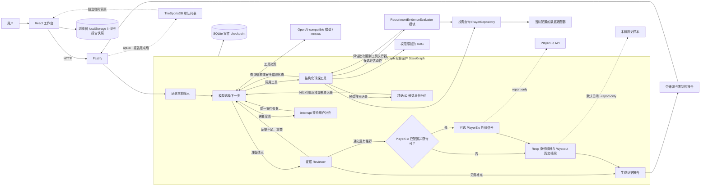

# TactiScout 架构与对话设计

这份文档记录产品对话链路、LangGraph 控制流、服务边界与本地状态的设计。作品集入口见 [README](../README.md)。

## 对话链路

```text
用户描述需求
  → LLM 选择下一步调查动作
  → LangGraph 检索角色/战术方法资料，协助建立能力画像
  → 结构化筛选候选并评估比赛数据
  → 再检索许可登记内的球员报告，补充定性观察
  → 报告发现新名字时，回到结构化检索和数据核验
  → 工具证据回到案件状态，LLM 再决定下一步
  → 需要用户补充时 interrupt 暂停；同一案件收到回答后恢复
  → Reviewer 校验推荐是否引用已计算的证据
  → 返回逐人推荐、可观测指标、样本与数据限制
```

年龄、位置、预算等不是开场必填字段。Agent 只有在答案会明显改变候选评估时才追问。数据覆盖无法回答的问题会作为限制说明；历史比赛阵容不作为当前完整阵容。

若 StatsBomb 有阵容记录但缺少对应比赛事件文件，球员仍可作为调查线索出现，但不生成表现指标或推荐依据；没有传球尝试时，传球成功率会标为不可用而不是 0。

球员报告是带出处的定性线索，不能直接折算成能力分。启动检索时会预置两条根据 CC BY 方法论文撰写的项目摘要；原文可按已登记的 DOI 命令写入本地索引。当前没有具名球员报告语料，所以报告检索为空时会明确显示。

用户可以用可选的可搜索球队选择器补充目标球队。招募计划、对话记录和最近一份完整报告保存在浏览器 `localStorage`，旧版本单次分析计划会迁移成历史报告快照。删除浏览器站点数据会移除本地计划。

## 架构一览



LangGraph 控制工具选择、结果回流、用户追问恢复、证据复核和报告生成；typed tool executor 只负责校验后的动作分发。候选评估交给 `RecruitmentEvidenceEvaluator`：它从现有 `PlayerRepository` 读取已发现且仍符合最新条件的记录和比较样本，按同一 provider、来源赛事 ID、来源赛季 ID 与位置构造比较组，再用来源实际提供的指标计算百分位与样本限制；来源 ID 缺失时，比较范围退回来源名及展示赛事/赛季标签。它不会决定下一项调查动作，也不引入新的评分权重。用户多轮输入中的明确位置、年龄、分钟、赛事与赛季条件由 `resolveCandidateSearchIntent` 统一解析，再用于候选搜索、评估资格和报告过滤；数据适配器只按结构化条件取数。受约束的 Planner 还会收到一份由案件状态计算的能力证据覆盖摘要：它能看到用户要求的维度在已评估候选中是缺失、部分覆盖还是已观察，并据此考虑是否继续读取下一页或在报告中披露缺口。同一份覆盖状态也会写入报告，并以“能力证据覆盖”卡片展示测量状态和候选人数；没有对应指标时会明确说当前数据无法测量，不会用相邻统计替代。候选查询失败与成功的零匹配保持为不同状态：失败写入案件状态和 Planner 可见的工具历史，Planner 可以在工具预算内调整后续调查；FBref 的访问拒绝或限流会由确定性策略停止该来源请求，未恢复的错误会进入报告并说明覆盖未知。错误内容会先裁剪和脱敏。PlayerElo 和跨来源历史档案只在复核后以默认关闭的 report-only 方式补充，不参与 Agent 评分或推荐排序。TheSportsDB 球队列表在报告生成后由 API 可选读取，仅作为单独的球队背景参考；它不进入 LangGraph、checkpoint、保存的报告或评分。

候选搜索返回后，身份分组器只将 Reep 注册表确认的唯一有效身份 ID 作为跨来源分组键。分组引用保存在 LangGraph 案件状态，并随候选摘要提供给 Planner、Reviewer 和报告组装；每条来源记录依旧单独评估和引用，比较样本也继续按 provider、来源赛事、赛季与位置隔离。缺少映射、存在歧义、来源 ID 不稳定或本机索引不可用时，候选分别保留并在报告标出解析状态。身份分组不等于当前效力核验，也不表示已覆盖全部候选市场。

## 技术结构

- React + TypeScript：自然语言对话、追问输入、证据报告、候选人比较和本地计划。
- Fastify：对话案件 HTTP 接口与共享 Zod 请求/响应契约。
- LangGraph `StateGraph`：共享案件状态、模型决策与数据工具循环、条件路由、`interrupt` 人机交互、证据审核与 checkpoint。外层案件步骤由图控制，阶段内由模型按工具结果决定继续调查、补查、追问或结束；v3 event stream 的 typed projection 从节点 custom event 中提取白名单进度，前端只接收阶段状态和安全结果计数。用户可主动停止当前回合，request-scoped 取消信号从 LangGraph 经过 typed tool executor 传至候选/球队查询、RAG 和 evaluator；Understat/ASA/mosaic 的 fetch 将其与请求超时组合，缓存共享请求只有在所有订阅者都取消后才中止。Transformers.js embedding 与 LanceDB 查询不提供这里使用的协作式取消接口，因此当前在等待前后检查 signal：底层单次调用可能先完成，但结果会被丢弃，且图不会继续下一项工具或生成报告。取消错误不会作为普通来源失败恢复。停止请求送达后仍显示“正在结束”，只有图实际退出后才记录取消终态。可能不完整的 checkpoint 不会被继续复用。结束后这组安全事件仍可从助手消息中展开查看，并随已保存的招募计划保留。工作台的对话区域只播报新增消息，调查区单独播报当前状态，逐秒更新的等待时长不会触发整段对话的反复朗读。
- `RecruitmentPlanner` seam 与 `recruitment-planner.ts`：OpenAI-compatible 模型适配器负责分阶段提示词和结构化 action 解析；LangGraph 决定何时调用 Planner，并继续持有案件状态、策略改写、工具执行及条件路由。测试和其他本地适配器可以注入同一 Planner interface。
- `@langchain/openai`：服务端调用兼容 OpenAI 的模型；密钥不会发送到浏览器。
- 数据产品主线是 TactiScout 自建、版本化的球探证据集：对有出处的数据确定性地计算自有指标，复用第一方观察记录补充比赛情境；报告保留上游来源、样本与限制。数据适配器只是采集入口。首版边界和后续构建以 [issue 40](../.scratch/tactiscout-mvp/issues/40-tactiscout-owned-scouting-dataset.md) 为准。
- LanceDB 本地索引、许可登记门控和 Transformers.js multilingual E5 q8 本地 embedding。第一次执行 RAG 检索时会下载量化模型权重并缓存。也可显式切换到兼容 OpenAI 的 embedding 服务；切换前要考虑文档会发送给该服务处理。

招募案件的 LangGraph checkpoint 默认保存在本地 SQLite 文件 `.data/recruitment-cases.sqlite`；可用 `TACTISCOUT_CHECKPOINT_PATH` 改位置。API 进程重启后，已暂停案件可通过原 `caseId` 恢复。浏览器每轮请求附带短期幂等 ID：同一 ID 和相同输入重发时，共用进行中的图执行或返回近期结果，避免网络响应丢失后重复运行工具；不同输入不能复用该 ID。进行中的回合可通过 `POST /api/v1/recruitment/cases/:caseId/turns/:requestId/cancel` 主动停止；服务先显示停止请求处理中，LangGraph 实际退出后才返回取消终态。取消后前端保留最近完整报告，并以新案件和可见对话上下文继续，避免重用中途 checkpoint。进度快照也按请求 ID 匹配，避免恢复时显示同案上一轮轨迹。幂等结果缓存仅在当前 API 进程内，重启后不保留。浏览器中的对话记录和招募计划/报告快照仍由 `localStorage` 保存；浏览器数据与服务端图执行状态是两类独立数据。同一个案件在单个 API 进程内串行处理，不同案件可以并行。当前 SQLite saver 与进程内互斥适用于本机单进程原型；多进程部署需要共享 checkpoint 后端和跨进程互斥方案。
